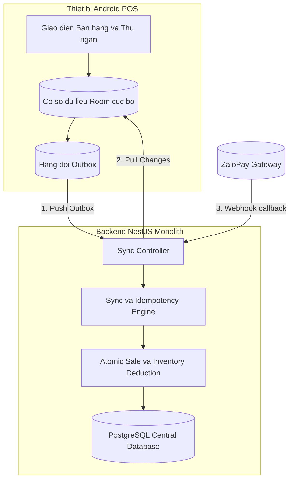

# Kế hoạch Triển khai Backend API & Động cơ Đồng bộ (Sync Engine) cho Hệ thống POS

Tài liệu này xác lập lộ trình chi tiết để xây dựng toàn bộ **Cơ sở dữ liệu (PostgreSQL/Prisma)**, **Các module API nghiệp vụ (NestJS Modular Monolith)** và **Động cơ đồng bộ dữ liệu hai chiều (Sync Engine)** kết nối với ứng dụng Android POS.

> [!IMPORTANT]
> **Nguyên tắc phân lập:** Tuyệt đối không chỉnh sửa bất kỳ tệp tin nào trong thư mục `apps/pos` để tránh xung đột với agent Codex đang thiết kế ứng dụng Android POS. Mọi công việc chỉ diễn ra tại `apps/api`, `docs/` và hạ tầng database.

---

## 1. Tổng quan kiến trúc & Luồng đồng bộ giữa Backend và POS

---

## 2. Lộ trình triển khai chi tiết

### Giai đoạn 1: Hoàn thiện Cơ sở dữ liệu (PostgreSQL & Prisma Migrations)
Hiện tại `apps/api/prisma/schema.prisma` đã có `Store`, `User`, `Device`, `AttendanceRecord`, `CashierSession`, `ProductCategory`, `Product`, `ProductVariant`, `Topping`. Cần bổ sung các bảng cốt lõi còn lại theo đúng tài liệu `docs/14-data-model.md`:

1. **Nhóm Công thức & Kho nguyên liệu (`recipe_inventory`):**
   - `ingredients`: Danh mục nguyên liệu chuẩn (mã, tên, đơn vị cơ sở `g`, `ml`, `piece`).
   - `recipe_versions` & `recipe_items`: Phiên bản công thức định mức gắn theo từng Size/Variant của món (trạng thái `DRAFT`, `ACTIVE`, `RETIRED`).
   - `topping_items`: Công thức định mức tiêu hao nguyên liệu của từng loại Topping (hỗ trợ nhân số lượng topping).
   - `stock_balances`: Tồn kho hiện thời theo từng cửa hàng (`store_id`, `ingredient_id`, `quantity`, `version`).
   - `stock_movements`: Lịch sử biến động kho bất biến (append-only: `RECEIPT`, `SALE_USAGE`, `ADJUSTMENT`, `WASTE`).

2. **Nhóm Bán hàng, Thanh toán & Giao ca (`sales_payments_register`):**
   - `register_sessions`: Phiên tiền mặt giao ca của máy POS (tiền đầu ca, tiền thực tế đếm được, chênh lệch `variance_vnd`).
   - `sales`: Đơn hàng bán ra (lưu `subtotal_vnd`, `tax_vnd`, `total_vnd` theo cơ chế VAT Inclusive, `status: PAID`).
   - `sale_items`: Từng dòng món bán ra (snapshot nguyên vẹn variant, recipe, thuế VAT tại thời điểm bán).
   - `sale_item_toppings`: Snapshot topping đã chọn và đơn giá đi kèm món.
   - `sale_item_consumptions`: Snapshot định mức tiêu hao nguyên liệu thực tế tổng hợp từ món chính và các topping.
   - `payments`: Giao dịch thanh toán (`CASH`, `ZALOPAY`, mã giao dịch merchant/provider).

3. **Nhóm Động cơ Đồng bộ (`sync_engine`):**
   - `sync_operations`: Bảng chống trùng lặp (Idempotency) với khóa chính `operation_id` (UUID), `device_id`, `store_id`, `payload_hash`, `status`, `result`.
   - `sync_changes`: Bảng lưu change log toàn chuỗi và từng chi nhánh theo `cursor` tăng đơn điệu.
   - `device_sync_checkpoints`: Lưu checkpoint cursor cuối cùng mà máy POS đã kéo về thành công.

---

### Giai đoạn 2: Xây dựng các Module Nghiệp vụ Backend API (NestJS)

1. **`inventory` Module (`/api/v1/ingredients`, `/api/v1/recipes`, `/api/v1/stores/{id}/stock`):**
   - Quản lý Master data nguyên liệu và định mức công thức chuẩn cho từng Size/Variant.
   - API tra cứu tồn kho tức thời tại chi nhánh.
   - API kiểm kê kho, nhập hàng (`RECEIPT`) và ghi nhận hao hụt (`WASTE`).

2. **`sales` Module & Engine Trừ kho nguyên tử:**
   - Dịch vụ hoàn tất đơn hàng: Thực thi toàn bộ thao tác trong **1 Database Transaction duy nhất**:
     * Ghi nhận đơn hàng `sales` và các dòng món `sale_items`.
     * Tính toán tổng tiêu hao và ghi nhận `sale_item_consumptions`.
     * Cập nhật `stock_balances` và ghi `stock_movements` (loại `SALE_USAGE`).
     * Khóa dòng (Row Lock) bảng `stock_balances` theo thứ tự `ingredient_id` tăng dần để loại bỏ triệt để nguy cơ Deadlock khi nhiều đơn xử lý đồng thời.
   - API xem chi tiết đơn hàng và xuất thông tin in biên lai (`GET /api/v1/sales/{id}/receipt`).

3. **`register-sessions` Module (`/api/v1/register-sessions`):**
   - Mở phiên tiền mặt đầu ca: Ghi nhận số tiền ban đầu (`opening_cash_vnd`).
   - Đóng ca / giao ca: Đối soát tổng tiền bán mặt trong ca so với tiền thực tế nhân viên kiểm đếm, tính toán chênh lệch thừa/thiếu (`variance_vnd`).

4. **`payments` Module & Tích hợp Cổng thanh toán ZaloPay Sandbox:**
   - `POST /api/v1/payments/zalopay/create-order`: POS yêu cầu backend gọi API ZaloPay Sandbox tạo đơn thanh toán, sinh mã QR động (yêu cầu online).
   - `POST /api/v1/webhooks/zalopay`: Webhook công khai nhận callback từ ZaloPay, xác thực chữ ký số HMAC-SHA256 với `key2`, cập nhật trạng thái `PAID` và kích hoạt trừ kho nguyên tử.
   - `GET /api/v1/payments/{id}/status`: Cho phép POS tra cứu trạng thái thanh toán khi cần.

---

### Giai đoạn 3: Xây dựng Động cơ Đồng bộ hai chiều (Sync Engine)

1. **Luồng Đồng bộ ngược từ POS lên Server (`POST /api/v1/sync/push`):**
   - Nhận mảng các operations từ Outbox của máy POS (ví dụ: `CASH_SALE_COMPLETED`, `REGISTER_SESSION_CLOSED`...).
   - **Xử lý Idempotency chuẩn mực:**
     * Trích xuất `operationId` và tính `payloadHash`.
     * Nếu `operationId` đã tồn tại và trùng hash: Trả lại kết quả thành công đã lưu trong `sync_operations.result` (tránh tạo đơn/trừ kho 2 lần khi POS retry do rớt mạng).
     * Nếu cùng `operationId` nhưng hash khác: Trả mã lỗi `409 OPERATION_PAYLOAD_MISMATCH`.
     * Nếu là thao tác mới: Thực thi transaction nghiệp vụ, lưu lại kết quả và phản hồi cho POS đánh dấu Outbox hoàn thành.
   - **Bảo mật Store-Scope:** Toàn bộ `storeId` và `deviceId` đều được trích xuất từ Device Credential đã xác thực qua Header, không tin cậy dữ liệu `storeId` do client gửi trong body.

2. **Luồng Đồng bộ xuôi từ Server về POS (`GET /api/v1/sync/pull`):**
   - Nhận tham số `cursor` và `limit` từ POS.
   - Trả về danh sách thay đổi (`changes`): Danh mục món, giá bán, công thức, danh sách nhân sự được phép đăng nhập (chỉ trả `pin_version`, **tuyệt đối không gửi PIN hash** về POS để bảo vệ an toàn), cấu hình cửa hàng.
   - Phản hồi `nextCursor` để POS cập nhật sau khi đã lưu thành công vào Room DB.

---

### Giai đoạn 4: Kiểm thử Tích hợp & Xác minh (Verification Baseline)

1. **Kiểm thử Database Constraints:**
   - Đảm bảo một chi nhánh chỉ có duy nhất 1 thiết bị POS ở trạng thái `ACTIVE`.
   - Kiểm tra ràng buộc tồn kho không âm (`stock_balances.quantity >= 0`).
2. **Kiểm thử Idempotency:**
   - Gửi cùng một `operationId` của đơn bán hàng nhiều lần để xác minh hệ thống không tạo trùng đơn hay trừ kho lặp lại.
3. **Kiểm thử Giao dịch Nguyên tử (Atomic Transaction):**
   - Giả lập lỗi giữa chừng khi trừ kho để xác minh đơn hàng và payment được rollback hoàn toàn 100%.
4. **Kiểm thử Luồng ZaloPay Callback:**
   - Kiểm tra xác thực chữ ký HMAC callback và cơ chế chống replay attack.

---

## 3. Thứ tự các bước thực hiện tiếp theo

| Bước | Hạng mục công việc | Phạm vi tệp tin (Tuyệt đối không đụng `apps/pos`) |
| :---: | :--- | :--- |
| **B1** | Bổ sung Prisma schema cho Inventory, Recipe, Sales, Payments, Register, Sync | `apps/api/prisma/schema.prisma` |
| **B2** | Tạo và chạy Prisma migration PostgreSQL | `apps/api/prisma/migrations/` |
| **B3** | Cập nhật database seed mẫu (nguyên liệu, công thức, tồn kho ban đầu) | `apps/api/prisma/seed.ts` |
| **B4** | Triển khai `inventory` & `recipes` module | `apps/api/src/inventory/` |
| **B5** | Triển khai `sales` & `payments` module (kèm ZaloPay sandbox adapter) | `apps/api/src/sales/`, `apps/api/src/payments/` |
| **B6** | Triển khai `sync` module (`POST /sync/push` & `GET /sync/pull`) | `apps/api/src/sync/` |
| **B7** | Viết Integration Tests kiểm chứng toàn bộ luồng đồng bộ | `apps/api/test/` |
