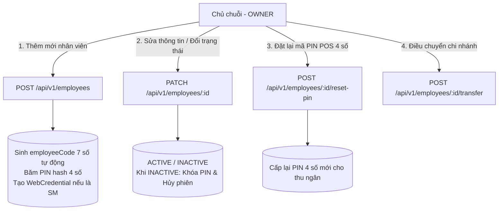

# KẾ HOẠCH TOÀN DIỆN: CHUẨN HÓA DỮ LIỆU, TÍNH NĂNG NHẬP HÀNG, QUẢN TRỊ NHÂN SỰ & TÁI CẤU TRÚC ĐIỀU HƯỚNG WEB

> **Dự án:** Hệ thống Chuỗi Cà phê Coffee POS (Multi-Branch Offline-First)  
> **Tài liệu tham chiếu:** `docs/01-scope.md`, `docs/05-inventory-recipe.md`, `docs/20-master-catalog-and-recipe-spec.md`  
> **Thời điểm cập nhật:** 08/10/2026

---

## 1. BÁO CÁO HIỆN TRẠNG DỮ LIỆU DATABASE SAU KHI LÀM SẠCH (FRESH DB)

Hệ thống đã thực hiện dọn dẹp sạch sẽ toàn bộ dữ liệu rác phát sinh từ các bài kiểm thử E2E tự động, đưa cơ sở dữ liệu về trạng thái chuẩn hóa 100% khớp với tài liệu đặc tả [docs/20-master-catalog-and-recipe-spec.md](file:///d:/Final%20Project/docs/20-master-catalog-and-recipe-spec.md):

| Thực thể dữ liệu | Số lượng trước khi dọn | Số lượng sau khi Fresh | Trạng thái chuẩn hóa |
|---|:---:|:---:|---|
| **Người dùng (`users`)** | **103** *(bị rác do test)* | **4** *(chuẩn)* | 1 Chủ chuỗi (Owner), 2 Cửa hàng trưởng (SM Q1, SM Q2), 1 Thu ngân (Cashier Q1) |
| **Danh mục (`product_categories`)** | **33** *(bị rác do test)* | **4** *(chuẩn)* | Cà phê, Trà & Trà trái cây, Trà sữa & Đá xay, Bánh & Món ăn kèm |
| **Sản phẩm (`products`)** | 57 | **28** | 9 Cà phê, 6 Trà, 6 Trà sữa/Đá xay, 7 Bánh & Món kèm (Mỗi nhóm $\ge 6$ món) |
| **Biến thể & Giá (`product_variants`)** | 101 | **72** | Đủ 3 size S/M/L cho đồ uống, 1 size cho bánh, giá niêm yết từ 25.000đ - 62.000đ |
| **Nguyên liệu chuẩn (`ingredients`)** | 58 | **21** | Đủ 21 nguyên liệu nền (Robusta, Arabica, sữa tươi, kem muối, siro, matcha, đào...) |
| **Topping bán kèm (`toppings`)** | 5 | **5** | Trân châu đen (10k), Thạch cà phê (10k), Đào miếng (10k), Kem cheese (12k), Hạt sen (12k) |
| **Định mức công thức (`recipe_versions`)** | 112 | **72** | Toàn bộ 72 biến thể đều có phiên bản công thức Version 1 ACTIVE |
| **Chi nhánh (`stores`)** | 2 | **2** | Chi nhánh Quận 1 (DEMO-HCM-01), Chi nhánh Thảo Điền (DEMO-HCM-02) |
| **Số dư tồn kho (`stock_balances`)** | 72 | **42** | 21 nguyên liệu $\times$ 2 chi nhánh, cấp hạn mức tồn ban đầu dồi dào |

---

## 2. LÝ GIẢI VẤN ĐỀ 103 NHÂN VIÊN & KẾ HOẠCH QUẢN TRỊ NHÂN VIÊN CHO OWNER

### 2.1 Tại sao trên Web trước đó hiển thị 103 nhân viên?
- Trong các bài kiểm thử tích hợp tự động E2E (`sync-sales-integration.e2e-spec.ts`, `foundation.e2e-spec.ts`), mỗi lượt chạy test hệ thống tự động sinh ra hàng loạt tài khoản nhân viên ngẫu nhiên (ví dụ: `Nguyễn Thu Ngân E2E` thuộc các Store test `TEST-SYNC-...`) mà không có cơ chế dọn dẹp sau khi chạy test (`afterAll`).
- Vì vậy, cơ sở dữ liệu tích tụ qua nhiều lần chạy test dẫn đến con số 103 người.
- **Hiện tại:** Database đã được fresh sạch bóng, chỉ còn đúng 4 nhân sự nòng cốt. Lệnh `npm run db:fresh` đã được bổ sung vào `package.json` để có thể reset DB bất cứ lúc nào.

### 2.2 Kế hoạch xây dựng chức năng Quản trị nhân sự cho Owner (Owner HR Management)
Hiện tại Backend chỉ mới hỗ trợ xem danh sách và điều chuyển chi nhánh. Cần bổ sung đầy đủ bộ công cụ quản trị nhân sự cho Chủ chuỗi:



#### Các API Backend cần bổ sung:
1. `POST /api/v1/employees`:
   - Dữ liệu gửi: `fullName`, `role` (`STORE_MANAGER` / `EMPLOYEE`), `homeStoreId`, `initialPin` (4 chữ số).
   - Logic: Tự động sinh `employeeCode` 7 chữ số (ví dụ: `2000005`, `2000006`), băm mã PIN lưu vào `employee_pin_credentials`. Nếu vai trò là `STORE_MANAGER`, cho phép nhập email để cấp tài khoản Web.
2. `PATCH /api/v1/employees/:id`:
   - Dữ liệu gửi: `fullName`, `status` (`ACTIVE` hoặc `INACTIVE`).
   - Logic: Nếu chuyển sang `INACTIVE`, tự động đóng phiên thu ngân nếu đang mở, thu hồi quyền đăng nhập POS và ghi audit log.
3. `POST /api/v1/employees/:id/reset-pin`:
   - Dữ liệu gửi: `newPin` (4 chữ số).
   - Logic: Cập nhật băm `pinHash`, đặt lại `failedAttempts = 0`, mở khóa `lockedUntil = null`.

---

## 3. BỔ SUNG ĐƠN GIÁ NGUYÊN LIỆU & THIẾT KẾ TÍNH NĂNG NHẬP HÀNG (`RECEIPT`)

### 3.1 Bảng định giá vốn ban đầu cho 21 nguyên liệu chuẩn master
Đơn giá được quy về **đơn vị cơ sở (`G`, `ML`, `PIECE`)** phù hợp với quy tắc tính toán của hệ thống và tiền tệ VND:

| Mã nguyên liệu | Tên nguyên liệu | Đơn vị | Quy cách thương mại tham khảo | Đơn giá vốn cơ sở (`costPriceVnd`) |
|---|---|:---:|---|:---:|
| `ING_COFFEE_ROBUSTA` | Hạt Robusta Pleiku | `G` | Bao 1 kg (180.000 đ) | **180 đ / g** |
| `ING_COFFEE_ARABICA` | Hạt Arabica Cầu Đất | `G` | Bao 1 kg (280.000 đ) | **280 đ / g** |
| `ING_CONDENSED_MILK` | Sữa đặc Phương Nam | `G` | Hộp 1 kg (45.000 đ) | **45 đ / g** |
| `ING_FRESH_MILK` | Sữa tươi Dalat Milk | `ML` | Can 1 lít (36.000 đ) | **36 đ / ml** |
| `ING_SALT_CREAM` | Kem béo muối biển | `ML` | Bình 1 lít (90.000 đ) | **90 đ / ml** |
| `ING_SYRUP_CARAMEL` | Siro Caramel Torani | `ML` | Chai 750 ml (180.000 đ) | **240 đ / ml** |
| `ING_SYRUP_VANILLA` | Siro Vanilla tự nhiên | `ML` | Chai 750 ml (180.000 đ) | **240 đ / ml** |
| `ING_SYRUP_PEACH` | Siro Đào nguyên chất | `ML` | Chai 750 ml (165.000 đ) | **220 đ / ml** |
| `ING_SYRUP_LYCHEE` | Siro Vải ngọt thanh | `ML` | Chai 750 ml (165.000 đ) | **220 đ / ml** |
| `ING_TEA_OOLONG` | Cốt trà Ô long rang | `ML` | Cốt pha 1 lít (50.000 đ) | **50 đ / ml** |
| `ING_TEA_JASMINE` | Cốt trà Lài | `ML` | Cốt pha 1 lít (45.000 đ) | **45 đ / ml** |
| `ING_MATCHA_POWDER` | Bột Uji Matcha | `G` | Gói 1 kg (600.000 đ) | **600 đ / g** |
| `ING_COCOA_POWDER` | Bột Cacao nguyên chất | `G` | Gói 1 kg (250.000 đ) | **250 đ / g** |
| `ING_PEARL_RAW` | Trân châu đen nấu sẵn | `G` | Túi 1 kg (60.000 đ) | **60 đ / g** |
| `ING_COFFEE_JELLY` | Thạch cà phê giòn | `G` | Túi 1 kg (50.000 đ) | **50 đ / g** |
| `ING_PEACH_SLICES` | Đào miếng ngâm đường | `G` | Hộp 820 g (65.000 đ) | **80 đ / g** |
| `ING_CHEESE_CREAM` | Váng sữa phô mai | `ML` | Bình 1 lít (120.000 đ) | **120 đ / ml** |
| `ING_LOTUS_SEED` | Hạt sen ninh đường | `G` | Hộp 1 kg (110.000 đ) | **110 đ / g** |
| `ING_CROISSANT_DOUGH` | Bánh sừng bò đông lạnh | `PIECE` | Khay bánh | **12.000 đ / cái** |
| `ING_TIRAMISU_CAKE` | Bánh Mousse Tiramisu | `PIECE` | Phần bánh chia sẵn | **22.000 đ / cái** |
| `ING_CHEESECAKE` | Bánh phô mai Basque | `PIECE` | Phần bánh chia sẵn | **25.000 đ / cái** |

### 3.2 Thiết kế kiến trúc tính năng Nhập hàng (Inbound Stock Receipt)

1. **Cập nhật Database Schema:**
   - Bổ sung `costPriceVnd BigInt @default(0) @map("cost_price_vnd")` vào bảng `ingredients`.
   - Bổ sung `unitCostVnd BigInt? @map("unit_cost_vnd")` và `totalCostVnd BigInt? @map("total_cost_vnd")` vào bảng `stock_movements`.
2. **Nâng cấp API Nhập kho:**
   - Tận dụng endpoint sẵn có: `POST /api/v1/stores/:storeId/stock-adjustments` với `movementType: 'RECEIPT'`.
   - Bổ sung tham số trong item: `unitCostVnd` (nếu người dùng không nhập, tự động lấy `costPriceVnd` mặc định của nguyên liệu).
   - Tự động tính thành tiền: `totalCostVnd = quantityDelta * unitCostVnd`.
   - Lưu tên nhà cung cấp, mã số phiếu giao hàng trong `reason`.
3. **Quy tắc bảo vệ dữ liệu Offline-First:**
   - Theo [docs/01-scope.md](file:///d:/Final%20Project/docs/01-scope.md): Chỉ cho phép nhập kho khi POS của chi nhánh đang **ONLINE** (heartbeat < 90s) và đã đẩy sạch Outbox lên server.
   - Khi hoàn tất, Backend tự động sinh bản ghi trong `sync_changes` để máy POS kéo delta cập nhật ngay số tồn kho mới nhất.

---

## 4. TÁI CẤU TRÚC THANH TASKBAR / SIDEBAR BÊN TRÁI TRANG WEB

Để giao diện quản trị trực quan, chuyên nghiệp và tránh việc gộp quá nhiều tính năng vào một trang duy nhất, thanh điều hướng bên trái (`sidebar`) được chia nhỏ theo các phân hệ nghiệp vụ cụ thể:

```text
┌─────────────────────────────────────────────────────────────────┐
│                    COFFEE POS MANAGEMENT                       │
├─────────────────────────────────────────────────────────────────┤
│ ▼ ĐIỀU HÀNH CHUỖI                                               │
│   ├─ 📊 Tổng quan chuỗi             (/dashboard)               │
│   └─ 🏬 Chi nhánh & Máy POS         (/stores)                  │
│                                                                 │
│ ▼ THỰC ĐƠN & BÁN LẺ                                             │
│   ├─ ☕ Món & Biến thể giá          (/menu-products)           │
│   ├─ 🗂️ Danh mục & Thuế VAT         (/menu-categories)         │
│   └─ 🧋 Topping bán kèm             (/menu-toppings)           │
│                                                                 │
│ ▼ KHO & CÔNG THỨC                                               │
│   ├─ 📦 Tồn kho chi nhánh           (/inventory-balances)      │
│   ├─ 📥 Nhập hàng & Phiếu kho       (/inventory-receipts)      │
│   ├─ 📑 Định mức công thức (BOM)    (/inventory-recipes)       │
│   └─ ⚖️ Kiểm kê & Hao hụt           (/inventory-adjustments)   │
│                                                                 │
│ ▼ NHÂN SỰ & CHẤM CÔNG                                           │
│   ├─ 👥 Quản trị nhân viên          (/hr-employees)            │
│   └─ ⏰ Lịch sử chấm công           (/hr-attendance)           │
│                                                                 │
│ ▼ TÀI CHÍNH & BÁO CÁO                                           │
│   ├─ 🧾 Hóa đơn & Bán hàng          (/sales)                   │
│   └─ 💵 Phiên két tiền mặt          (/register)                │
└─────────────────────────────────────────────────────────────────┘
```

### Chi tiết các phân hệ con được chia nhỏ:

1. **Kho & Công thức (Inventory & Recipes):**
   - **Tồn kho chi nhánh (`inventory-balances`):** Xem nhanh tồn kho 21 nguyên liệu, lọc theo chi nhánh, gắn thẻ cảnh báo màu vàng khi chạm ngưỡng an toàn.
   - **Nhập hàng & Phiếu kho (`inventory-receipts`):** Lập phiếu nhập nguyên liệu từ nhà cung cấp, ghi nhận số lượng và đơn giá, tính tổng chi phí nhập kho, xem lịch sử các lần nhập kho.
   - **Định mức công thức (`inventory-recipes`):** Tra cứu công thức pha chế của từng size S, M, L cho 28 món và định mức tiêu hao của 5 loại topping.
   - **Kiểm kê & Hao hụt (`inventory-adjustments`):** Ghi nhận hư hỏng nguyên liệu (`WASTE`) hoặc điều chỉnh chênh lệch kiểm kê thực tế (`ADJUSTMENT`).

2. **Thực đơn (Menu Management):**
   - **Món & Biến thể giá (`menu-products`):** Danh sách 28 món, điều chỉnh giá bán theo size, bật/tắt kinh doanh.
   - **Danh mục & Thuế VAT (`menu-categories`):** 4 nhóm danh mục, cấu hình thuế suất VAT (8% hoặc 10%).
   - **Topping (`menu-toppings`):** Danh mục 5 loại topping và giá bán.

3. **Nhân sự (Human Resources):**
   - **Quản trị nhân viên (`hr-employees`):** Bảng nhân sự toàn chuỗi, nút "Thêm nhân viên", "Đổi trạng thái", "Reset PIN 4 số", "Điều chuyển chi nhánh".
   - **Chấm công (`hr-attendance`):** Theo dõi ca làm, thời gian check-in/out, ca hỗ trợ ngoại chi nhánh, duyệt quên chấm công.

4. **Tài chính & Báo cáo (Finance & Reports):**
   - **Hóa đơn (`sales`):** Tra cứu danh sách đơn hàng, xem chi tiết tiền mặt/ZaloPay, xem snapshot nguyên liệu đã trừ kho.
   - **Phiên két tiền mặt (`register`):** Theo dõi tiền mở ca, tiền kết ca, chênh lệch thực tế vs lý thuyết của máy POS.

---

## 5. LỘ TRÌNH THỰC HIỆN TIẾP THEO

- [x] **Bước 1:** Dọn dẹp DB sạch sẽ, thiết lập script `npm run db:fresh`, nạp lại 28 món, 21 nguyên liệu, 5 topping, 4 tài khoản chuẩn.
- [ ] **Bước 2:** Bổ sung trường `costPriceVnd` cho `Ingredient` trong Prisma schema và cập nhật giá vốn ban đầu cho 21 nguyên liệu.
- [ ] **Bước 3:** Bổ sung API Quản trị nhân viên cho Owner (`POST /employees`, `PATCH /employees/:id`, `POST /employees/:id/reset-pin`).
- [ ] **Bước 4:** Nâng cấp API Nhập hàng `RECEIPT` kèm đơn giá và tổng tiền.
- [ ] **Bước 5:** Tái cấu trúc thanh Sidebar taskbar trên Web và xây dựng giao diện các trang con chuyên biệt.
