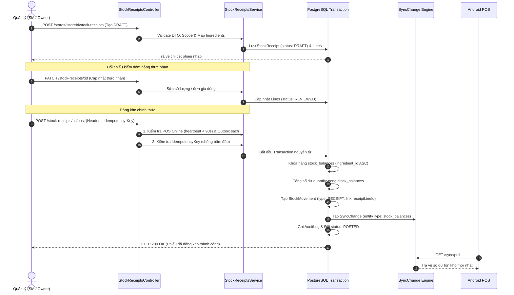

# BẢN KẾ HOẠCH HOÀN THIỆN: TÍNH NĂNG NHẬP NGUYÊN LIỆU & ĐIỀU HÀNH KHO TRÊN API

> **Tài liệu tham chiếu cốt lõi:**  
> - `docs/21-procurement-receiving-plan.md` *(Kế hoạch nhập nguyên liệu và chứng từ nguồn - Codex)*  
> - `docs/15-api-conventions.md` *(Quy ước REST API, OpenAPI, Store Scope & Transaction)*  
> - `docs/01-scope.md` & `docs/05-inventory-recipe.md` *(Phạm vi MVP & Nguyên tắc kho)*  
> - `docs/17-implementation-status.md` *(Trạng thái kiểm chứng thực tế hệ thống)*

---

## 1. BỐI CẢNH VÀ THAM VẤN VỚI THIẾT KẾ CỦA CODEX

Qua rà soát kỹ lưỡng các tài liệu kỹ thuật và biên bản trao đổi của Codex:

1. **Khắc phục triệt để sai lầm "nhét thông tin vào `reason`":**  
   Endpoint cũ `POST /stores/:storeId/stock-adjustments` chỉ dành cho kiểm kê định kỳ (`ADJUSTMENT`) hoặc hao hụt (`WASTE`). Việc nhét mã nhà cung cấp, số hóa đơn và đơn giá vào trường `reason` là sai quy chuẩn, không tạo được vết kiểm toán (audit trail), không đối soát được hóa đơn và không ngăn được trùng lặp.
2. **Thống nhất Phương án lai A2 (Đã được Chủ dự án duyệt):**  
   * **Bánh ngọt / Bánh mì làm sẵn:** Nhập từ Nhà cung cấp ngoài (`EXTERNAL_SUPPLIER`), quản lý theo đơn vị chiếc (`PIECE`). Bán ra tiêu hao `1 PIECE` thành phẩm.  
   * **Nguyên liệu pha chế:** Nhập từ nguồn kho nội bộ (`CENTRAL_WAREHOUSE_UNTRACKED`) theo đơn vị cơ sở khối lượng (`G`) hoặc thể tích (`ML`).  
   * **Ranh giới MVP:** Toàn bộ quá trình nhận hàng chỉ **tăng số dư tồn kho tại Chi nhánh nhận hàng (`store_id`)**. Hệ thống **không** quản lý số dư kho tổng, không tạo phiếu xuất kho tổng hay bút toán đối ứng (giữ đúng phạm vi MVP).
3. **Độ chính xác số học (Monetary & Decimal Precision):**  
   * Giá trên một đơn vị cơ sở g hoặc ml (ví dụ: 65.000 đ / 820g đào ngâm = 79.268 đ/g) bắt buộc phải dùng `Decimal(14, 2)` để không bị làm tròn sai số.  
   * Thành tiền từng dòng (`lineTotalVnd`) và Tổng tiền phiếu (`totalCostVnd`) làm tròn về số nguyên VND (`BigInt`).
4. **Bảo vệ toàn vẹn Offline-First:**  
   Phiếu chỉ được duyệt đăng kho (`POSTED`) khi máy POS của chi nhánh đang **Online** (heartbeat < 90s) và **đã đẩy sạch Outbox lên server**.

---

## 2. ĐẶC TẢ DATA MODEL (PRISMA SCHEMA)

Bổ sung 2 bảng mới vào `apps/api/prisma/schema.prisma` và mở rộng bảng `StockMovement`:

```prisma
// Bảng Header Phiếu nhập hàng
model StockReceipt {
  id              String    @id @db.Uuid
  storeId         BigInt    @map("store_id")
  receiptCode     String    @unique @map("receipt_code") @db.Text // Mã sinh tự động: REC-YYYYMMDD-XXXX
  sourceType      String    @map("source_type") @db.Text // EXTERNAL_SUPPLIER | CENTRAL_WAREHOUSE_UNTRACKED
  sourceName      String    @map("source_name") @db.Text // Tên nhà cung cấp bánh hoặc Tên kho cấp
  documentNo      String?   @map("document_no") @db.Text // Số hóa đơn GTGT / Số phiếu giao hàng nguồn
  documentDate    DateTime? @map("document_date") @db.Timestamptz(3)
  status          String    @default("DRAFT") @db.Text // DRAFT, REVIEWED, POSTED, REJECTED
  totalCostVnd    BigInt    @default(0) @map("total_cost_vnd") // Tổng tiền phiếu (VND)
  idempotencyKey  String?   @unique @map("idempotency_key") @db.Text // Chống nhấn đúp hoặc retry trùng
  note            String?   @db.Text
  rejectionReason String?   @map("rejection_reason") @db.Text // Lý do nếu bị từ chối
  createdByUserId BigInt    @map("created_by_user_id")
  reviewedByUserId BigInt?  @map("reviewed_by_user_id")
  postedByUserId  BigInt?   @map("posted_by_user_id")
  postedAt        DateTime? @map("posted_at") @db.Timestamptz(3)
  createdAt       DateTime  @default(now()) @map("created_at") @db.Timestamptz(3)
  updatedAt       DateTime  @updatedAt @map("updated_at") @db.Timestamptz(3)

  store           Store              @relation(fields: [storeId], references: [id], onDelete: Restrict)
  createdByUser   User               @relation("ReceiptCreatedByUser", fields: [createdByUserId], references: [id], onDelete: Restrict)
  reviewedByUser  User?              @relation("ReceiptReviewedByUser", fields: [reviewedByUserId], references: [id], onDelete: Restrict)
  postedByUser    User?              @relation("ReceiptPostedByUser", fields: [postedByUserId], references: [id], onDelete: Restrict)
  lines           StockReceiptLine[]

  @@index([storeId, status])
  @@index([createdAt])
  @@map("stock_receipts")
}

// Bảng Dòng chi tiết nguyên liệu nhập
model StockReceiptLine {
  id               String   @id @db.Uuid
  receiptId        String   @map("receipt_id") @db.Uuid
  ingredientId     BigInt   @map("ingredient_id")
  lineNumber       Int      @map("line_number")
  receivedQuantity Decimal  @map("received_quantity") @db.Decimal(14, 3) // Khối lượng / Số lượng nhận
  baseUnit         String   @map("base_unit") @db.Text // G, ML, PIECE
  unitCostVnd      Decimal  @default(0) @map("unit_cost_vnd") @db.Decimal(14, 2) // Đơn giá theo đơn vị cơ sở
  lineTotalVnd     BigInt   @default(0) @map("line_total_vnd") // Thành tiền dòng = round(receivedQuantity * unitCostVnd)
  validationErrors String?  @map("validation_errors") @db.Text // Lưu lỗi nếu import CSV dòng bị sai

  receipt          StockReceipt   @relation(fields: [receiptId], references: [id], onDelete: Cascade)
  ingredient       Ingredient     @relation(fields: [ingredientId], references: [id], onDelete: Restrict)
  stockMovement    StockMovement? @relation("ReceiptLineMovement")

  @@unique([receiptId, lineNumber])
  @@index([receiptId])
  @@index([ingredientId])
  @@map("stock_receipt_lines")
}
```

*Trong `StockMovement`:*
```prisma
  receiptLineId         String?   @unique @map("receipt_line_id") @db.Uuid
  receiptLine           StockReceiptLine? @relation("ReceiptLineMovement", fields: [receiptLineId], references: [id], onDelete: SetNull)
```

---

## 3. THIẾT KẾ CHI TIẾT CÁC THAO TÁC TRÊN API (API CONTRACTS)

Tuân thủ nghiêm ngặt [docs/15-api-conventions.md](file:///d:/Final%20Project/docs/15-api-conventions.md): URL Prefix `/api/v1`, xác thực Web Principal Bearer token, kiểm tra Store Scope, RFC 9457 Problem Details.



---

### 3.1 Endpoint 1: Tạo phiếu nhập kho thủ công
* **URL:** `POST /api/v1/stores/:storeId/stock-receipts`
* **Xác thực:** Bearer Token (`WebPrincipalUtil.requireOwnerOrManager(authHeader, storeId)`).
  * `OWNER`: Tạo cho bất kỳ chi nhánh nào.
  * `STORE_MANAGER`: Chỉ tạo cho chi nhánh nhà (`homeStoreId`).
* **Request Body:**
```json
{
  "sourceType": "EXTERNAL_SUPPLIER",
  "sourceName": "Công ty TNHH Bánh Tươi Sài Gòn",
  "documentNo": "HD-2026/08912",
  "documentDate": "2026-10-09T08:00:00.000Z",
  "note": "Giao đợt sáng 09/10",
  "lines": [
    {
      "ingredientId": "19",
      "receivedQuantity": 50,
      "unitCostVnd": 12000
    },
    {
      "ingredientId": "20",
      "receivedQuantity": 20,
      "unitCostVnd": 22000
    }
  ]
}
```
* **Xử lý:**
  1. Kiểm tra chi nhánh tồn tại và đang hoạt động.
  2. Xác thực từng `ingredientId`: Phải thuộc danh mục nguyên liệu active, tự động gán `baseUnit` từ DB.
  3. Tính toán: `lineTotalVnd = round(receivedQuantity * unitCostVnd)`, tính `totalCostVnd` tổng.
  4. Sinh mã phiếu duy nhất: `REC-YYYYMMDD-XXXX`.
  5. Lưu vào DB ở trạng thái `DRAFT`.
* **Response (HTTP 201 Created):** Trả về đối tượng `StockReceiptResponseDto` đầy đủ.

---

### 3.2 Endpoint 2: Nhập nhanh từ file CSV (Import CSV)
* **URL:** `POST /api/v1/stores/:storeId/stock-receipts/import-csv`
* **Xác thực:** Bearer Token (Owner / SM chi nhánh nhà).
* **Content-Type:** `multipart/form-data` (file `.csv`, UTF-8, tối đa 2MB).
* **Mẫu CSV chuẩn:**
```csv
ingredient_code,received_quantity,unit_cost_vnd,note
ING_COFFEE_ROBUSTA,10000,180,2 bao hạt Robusta 5kg
ING_FRESH_MILK,20000,36,20 bình sữa Dalat Milk 1L
ING_CROISSANT_DOUGH,60,12000,Khay bánh sừng bò
```
* **Xử lý:**
  1. Parse CSV an toàn (chống CSV Injection, chặn formula `=`, `+`, `-`, `@`).
  2. Map `ingredient_code` vào bảng `ingredients`. Dòng nào không tìm thấy mã hoặc `received_quantity <= 0` sẽ bị đánh dấu vào `validationErrors` của dòng đó.
  3. Header phiếu nhận thêm `sourceType`, `sourceName`, `documentNo` qua form-data.
  4. Nếu có dòng lỗi, phiếu vẫn được tạo ở trạng thái `DRAFT` kèm cảnh báo chi tiết từng dòng để người dùng sửa lại trên Web trước khi đăng kho; **tuyệt đối không tự ý thêm nguyên liệu rác vào database**.

---

### 3.3 Endpoint 3: Tra cứu danh sách phiếu nhập kho
* **URL:** `GET /api/v1/stores/:storeId/stock-receipts`
* **Query Params:**
  * `status`: `DRAFT` | `REVIEWED` | `POSTED` | `REJECTED`
  * `sourceType`: `EXTERNAL_SUPPLIER` | `CENTRAL_WAREHOUSE_UNTRACKED`
  * `fromDate`, `toDate`: Lọc khoảng thời gian (ISO date)
  * `page`: Mặc định 1
  * `pageSize`: Mặc định 20
* **Response (HTTP 200 OK):**
```json
{
  "items": [
    {
      "id": "c1f7a218-...",
      "receiptCode": "REC-20261009-0001",
      "sourceType": "EXTERNAL_SUPPLIER",
      "sourceName": "Công ty TNHH Bánh Tươi Sài Gòn",
      "documentNo": "HD-2026/08912",
      "status": "POSTED",
      "totalCostVnd": "1040000",
      "lineCount": 2,
      "createdByName": "Trần Văn Quản Lý",
      "postedByName": "Trần Văn Quản Lý",
      "postedAt": "2026-10-09T08:15:30.000Z",
      "createdAt": "2026-10-09T08:05:00.000Z"
    }
  ],
  "total": 1,
  "page": 1,
  "pageSize": 20,
  "totalPages": 1
}
```

---

### 3.4 Endpoint 4: Xem chi tiết phiếu nhập kho
* **URL:** `GET /api/v1/stock-receipts/:id`
* **Xác thực:** Bearer Token. SM chỉ xem được phiếu thuộc chi nhánh nhà mình.
* **Response (HTTP 200 OK):** Trả về đầy đủ header, danh sách `lines` (gồm tên nguyên liệu, mã code, đơn vị tính, số lượng nhận, đơn giá, thành tiền), và nhật ký người tạo/người duyệt.

---

### 3.5 Endpoint 5: Cập nhật phiếu nháp
* **URL:** `PATCH /api/v1/stock-receipts/:id`
* **Điều kiện:** Phiếu đang ở trạng thái `DRAFT` hoặc `REVIEWED`. Nếu phiếu đã `POSTED` hoặc `REJECTED`, backend trả lỗi `400 Bad Request: Phiếu đã khóa, không được phép chỉnh sửa.`
* **Xử lý:** Cho phép cập nhật lại số lượng thực nhận, đơn giá, số hóa đơn đính kèm hoặc ghi chú. Cập nhật trạng thái phiếu sang `REVIEWED`.

---

### 3.6 Endpoint 6: ĐĂNG KHO CHÍNH THỨC (POST TO INVENTORY)
* **URL:** `POST /api/v1/stock-receipts/:id/post`
* **Headers bắt buộc:**
  * `Authorization`: Bearer Token
  * `Idempotency-Key`: UUID (Chống duplicate request khi mạng chập chờn)
* **Kiểm tra điều kiện tiên quyết (Pre-conditions):**
  1. Phiếu đang ở trạng thái `DRAFT` hoặc `REVIEWED`, không có dòng nào chứa lỗi `validationErrors`.
  2. Quyền thực hiện: `OWNER` (duyệt mọi chi nhánh) hoặc `STORE_MANAGER` (duyệt chi nhánh nhà).
  3. **Kiểm tra thiết bị POS chi nhánh (Quy tắc Offline-First):**
     * Chi nhánh phải có thiết bị POS đang `ACTIVE`.
     * Thiết bị đang trực tuyến: `now - lastHeartbeatAt <= 90_000` (90 giây).
     * Thiết bị đã đồng bộ: `lastSyncedAt` không null.
     * Thiết bị không còn outbox tồn đọng: `hasPendingOutbox == false` và `outboxPendingCount == 0`.
     * *Nếu không thỏa mãn: Báo lỗi `400 Bad Request` kèm nguyên nhân cụ thể (ví dụ: "Máy POS chi nhánh đang offline" hoặc "Máy POS còn đơn chưa đồng bộ lên server").*
* **Thực thi Giao dịch nguyên tử (Atomic Database Transaction):**
  ```typescript
  await prisma.$transaction(async (tx) => {
    // 1. Sắp xếp danh sách ingredientId tăng dần để khóa hàng theo thứ tự (Chống Deadlock)
    const sortedLines = [...receipt.lines].sort((a, b) => 
      a.ingredientId < b.ingredientId ? -1 : 1
    );

    for (const line of sortedLines) {
      // 2. Tìm hoặc tạo số dư tồn kho
      const balance = await tx.stockBalance.upsert({
        where: { storeId_ingredientId: { storeId: receipt.storeId, ingredientId: line.ingredientId } },
        update: {
          quantity: { increment: line.receivedQuantity },
          version: { increment: 1n },
        },
        create: {
          storeId: receipt.storeId,
          ingredientId: line.ingredientId,
          quantity: line.receivedQuantity,
          version: 1n,
        },
      });

      // 3. Ghi biến động bất biến vào stock_movements
      await tx.stockMovement.create({
        data: {
          id: randomUUID(),
          storeId: receipt.storeId,
          ingredientId: line.ingredientId,
          movementType: 'RECEIPT',
          quantityDelta: line.receivedQuantity,
          balanceAfter: balance.quantity,
          performedByUserId: actorUserId,
          receiptLineId: line.id,
          reason: `Nhập kho theo phiếu ${receipt.receiptCode} (${receipt.sourceName})`,
          occurredAt: now,
        },
      });

      // 4. Tạo biến động sync_changes để máy POS kéo delta
      await tx.syncChange.create({
        data: {
          storeId: receipt.storeId,
          entityType: 'stock_balances',
          entityId: line.ingredientId.toString(),
          changeType: 'UPSERT',
          payload: {
            storeId: receipt.storeId.toString(),
            ingredientId: line.ingredientId.toString(),
            quantity: balance.quantity.toString(),
            updatedAt: now.toISOString(),
          },
          changedAt: now,
        },
      });
    }

    // 5. Cập nhật trạng thái phiếu sang POSTED
    await tx.stockReceipt.update({
      where: { id: receipt.id },
      data: {
        status: 'POSTED',
        postedByUserId: actorUserId,
        postedAt: now,
        idempotencyKey,
      },
    });

    // 6. Ghi Audit Log
    await tx.auditLog.create({
      data: {
        actorUserId,
        action: 'STOCK_RECEIPT_POSTED',
        entityType: 'stock_receipts',
        entityId: receipt.id,
        payload: { receiptCode: receipt.receiptCode, totalCostVnd: receipt.totalCostVnd.toString() },
      },
    });
  });
  ```
* **Xử lý Idempotency:** Nếu request gửi lại với cùng `Idempotency-Key` mà phiếu đã `POSTED`, server trả về kết quả thành công của phiếu đó ngay lập tức, **tuyệt đối không cộng kho lần 2**.

---

### 3.7 Endpoint 7: Từ chối / Hủy phiếu nháp
* **URL:** `POST /api/v1/stock-receipts/:id/reject`
* **Body:** `{ "reason": "Hàng giao bị hỏng bao bì, từ chối nhận toàn bộ" }`
* **Xử lý:** Chuyển `status = 'REJECTED'`, lưu `rejectionReason`. Không tác động đến kho. Lưu chứng từ và audit log phục vụ đối soát.

---

## 4. TIÊU CHÍ NGHIỆM THU (DEFINITION OF DONE)

1. **Kiểm thử Unit & Service:**
   * Tính toán chính xác `lineTotalVnd` và `totalCostVnd` với đơn giá thập phân `Decimal`.
   * Chặn hoàn toàn SM thao tác ngoài chi nhánh nhà (`403 Forbidden`).
   * Chặn thao tác `post` khi POS offline hoặc dirty outbox (`400 Bad Request`).
   * Đảm bảo tính Idempotent: 2 request `post` đồng thời cùng key chỉ ghi nhận 1 lần tăng kho.
2. **Kiểm thử Database & Migration:**
   * Migration tạo bảng `stock_receipts` và `stock_receipt_lines` chạy mượt mà trên PostgreSQL.
   * Ràng buộc khóa ngoại và unique index hoạt động chuẩn xác.
3. **Bảo toàn dữ liệu hiện tại:**
   * Tuyệt đối không xóa hay làm hỏng dữ liệu danh mục 28 món và 21 nguyên liệu chuẩn hiện có.
