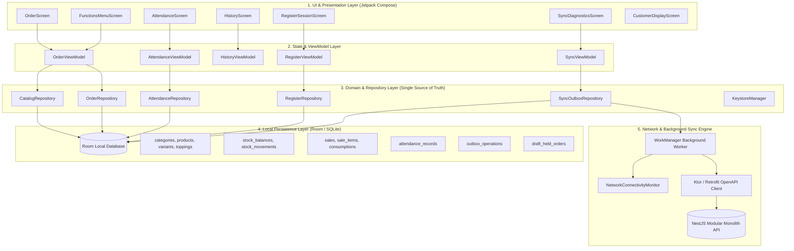

# Phác thảo Wireframe & Kiến trúc Component Jetpack Compose

Tài liệu này phác thảo chi tiết cấu trúc giao diện, hình ảnh mockup trực quan, sơ đồ wireframe và bộ khung code Kotlin / Jetpack Compose cho ứng dụng **UEH Coffee POS** (hướng đến tablet ngang 10.1 inch, độ phân giải $1280 \times 800\text{ dp}$, kiến trúc Offline-first đọc Room).

---

## 1. Bộ hình ảnh Mockup trực quan (Visual Mockups)


*Hình 1.1: Giao diện Order chính — TopBar thể hiện rõ chi nhánh và trạng thái mạng/sync; cột danh mục bên trái; lưới sản phẩm ở giữa; giỏ hàng thường trực bên phải kèm nút tăng giảm số lượng `− / +`, chi tiết size/topping/ghi chú và nút Đơn treo.*

---


*Hình 1.2: Giao diện Thanh toán — Tỷ lệ vàng 2 cột (Tóm tắt đơn 35% bên trái; Phương thức tiền mặt & ZaloPay QR 65% bên phải kèm bàn phím số cảm ứng lớn và nút mệnh giá chẵn).*

---


*Hình 1.3: Giao diện Điểm danh — Hai card hành động lớn "Vào ca" và "Ra ca"; form nhập mã 7 chữ số & bàn phím PIN; thông tin chi nhánh và thời gian.*

---

## 2. Bản vẽ Wireframe chi tiết (ASCII Wireframes)

### 2.1 Màn hình Order chính (Main Order Screen)
```text
┌────────────────────────────────────────────────────────────────────────────────────────┐
│ [☰ Menu]  CN Quận 1 ▾   Thu ngân: Mai Xuân Hoàng    14:30     🟢 Online   🔄 Sync: 0   │
├──────────────┬──────────────────────────────────────────┬──────────────────────────────┤
│ [Danh mục]   │ [🔍 Tìm tên món hoặc mã món...]           │ GIỎ HÀNG (3)  [📥 Treo (1)] [🗑️]│
│              ├──────────────────────────────────────────┼──────────────────────────────┤
│ ☕ Cà phê    │ ┌──────────────┐ ┌──────────────┐        │ 1. Trà sữa trân châu (L) −1+ │
│ (Active)     │ │ [Ảnh món]    │ │ [Ảnh món]    │        │    + Trân châu đen x1 (+10k) │
│              │ │ Cà phê sữa đá│ │ Bạc xỉu      │        │    * Ghi chú: Ít đá, 50% đg  │
│ 🧋 Trà sữa   │ │ 35.000 đ     │ │ 40.000 đ     │        │    Đơn giá: 65.000  TT: 65.000│
│              │ └──────────────┘ └──────────────┘        ├──────────────────────────────┤
│ 🥐 Đồ ăn     │ ┌──────────────┐ ┌──────────────┐        │ 2. Cà phê sữa đá (M)    −2+  │
│              │ │ [Ảnh món]    │ │ [Ảnh món]    │        │    Đơn giá: 35.000  TT: 70.000│
│ 📦 Khác      │ │ Trà đào cam sả│ │ Hồng trà sữa │        ├──────────────────────────────┤
│              │ │ 45.000 đ     │ │ 45.000 đ     │        │ Tạm tính (chưa VAT): 125.000 │
│              │ └──────────────┘ └──────────────┘        │ Thuế VAT (8%):        10.000 │
│              │ ┌──────────────┐                         │ TỔNG CỘNG:          135.000 đ│
│              │ │ [HẾT HÀNG]   │                         ├──────────────────────────────┤
│              │ │ Cold Brew    │                         │ [⏸️ LƯU ĐƠN]  [💳 THANH TOÁN]│
└──────────────┴──────────────────────────────────────────┴──────────────────────────────┘
```

### 2.2 Modal Dialog chọn Size, Topping & Ghi chú (Mở khi bấm vào món)
```text
┌────────────────────────────────────────────────────────────────┐
│ Trà sữa trân châu đường đen                           [ ✕ Đóng ]│
├────────────────────────────────────────────────────────────────┤
│ 1. CHỌN SIZE (Bắt buộc chọn 1)                                 │
│    ( ) Size S (Nhỏ)   (•) Size M (+5.000 đ)   ( ) Size L (+10k)│
├────────────────────────────────────────────────────────────────┤
│ 2. THÊM TOPPING (Tùy chọn, có thể chọn nhiều lần)              │
│    [✓] Trân châu đường đen (+10.000 đ)             [ − ] 1 [ + ]│
│    [ ] Thạch sương sáo     (+8.000 đ)              [ − ] 0 [ + ]│
│    [✓] Kem cheese Macchiato (+12.000 đ)            [ − ] 1 [ + ]│
├────────────────────────────────────────────────────────────────┤
│ 3. GHI CHÚ ĐẶC BIỆT                                            │
│    [ Ít đá, 50% đường, cho ly giấy                          ]   │
├────────────────────────────────────────────────────────────────┤
│ Đơn giá món: 67.000 đ                [ THÊM VÀO GIỎ HÀNG ]     │
└────────────────────────────────────────────────────────────────┘
```

### 2.3 Modal Danh sách Đơn treo (Held Orders)
```text
┌────────────────────────────────────────────────────────────────┐
│ DANH SÁCH ĐƠN HÀNG ĐANG TREO (2)                       [ ✕ Đóng ]│
├────────────────────────────────────────────────────────────────┤
│ • #DRAFT-01  |  14:15 (15 phút trước)                         │
│   2 món (1x Cà phê đen, 1x Bạc xỉu)           Tổng:  75.000 đ  │
│   [🗑️ Hủy đơn]                                  [ 📥 MỞ LẠI ]   │
├────────────────────────────────────────────────────────────────┤
│ • #DRAFT-02  |  14:26 (4 phút trước)                          │
│   4 món (Trà sữa trân châu, Trà đào...)       Tổng: 210.000 đ  │
│   [🗑️ Hủy đơn]                                  [ 📥 MỞ LẠI ]   │
└────────────────────────────────────────────────────────────────┘
```

---

## 3. Kiến trúc Component Jetpack Compose (Code Skeleton)

### 3.1 Cấu trúc gói UI trong `apps/pos`
```text
vn.id.congtc145.coffeepos.ui/
├── theme/               # Color, Type, Shape, Theme tokens
├── components/          # TopBar, Numpad, PriceTag, Badge
├── order/               # OrderScreen, CategoryRail, ProductGrid, CartPanel
├── order/dialogs/       # ProductCustomizationDialog, HeldOrdersDialog
├── checkout/            # CheckoutScreen, CashPaymentPanel, ZaloPayQrPanel
├── attendance/          # AttendanceScreen, MissedCheckoutDialog
└── customer/            # CustomerDisplayPresentation (Hỗ trợ máy 2 màn hình)
```

### 3.2 State Models (Trạng thái giao diện bất biến)
```kotlin
package vn.id.congtc145.coffeepos.ui.order

// Trạng thái giỏ hàng
data class CartItemUiState(
    val lineId: String,
    val productId: Long,
    val productName: String,
    val variantId: Long,
    val sizeLabel: String,
    val basePriceVnd: Long,
    val toppings: List<CartToppingUiState> = emptyList(),
    val note: String = "",
    val quantity: Int = 1,
    val taxRateBps: Int = 800 // 8%
) {
    val unitPriceVnd: Long
        get() = basePriceVnd + toppings.sumOf { it.priceVnd * it.quantity }
    val lineTotalVnd: Long
        get() = unitPriceVnd * quantity
    val taxAmountVnd: Long
        get() = lineTotalVnd - (lineTotalVnd * 10000L / (10000L + taxRateBps))
}

data class CartToppingUiState(
    val toppingId: Long,
    val name: String,
    val priceVnd: Long,
    val quantity: Int = 1
)

data class OrderScreenUiState(
    val storeName: String = "CN Quận 1",
    val cashierName: String = "Mai Xuân Hoàng",
    val isOnline: Boolean = true,
    val outboxPendingCount: Int = 0,
    val categories: List<CategoryUiModel> = emptyList(),
    val selectedCategoryId: Long? = null,
    val products: List<ProductUiModel> = emptyList(),
    val cartItems: List<CartItemUiState> = emptyList(),
    val heldOrdersCount: Int = 0,
    val isCustomizingProduct: ProductUiModel? = null,
    val isViewingHeldOrders: Boolean = false
) {
    val totalVnd: Long get() = cartItems.sumOf { it.lineTotalVnd }
    val totalTaxVnd: Long get() = cartItems.sumOf { it.taxAmountVnd }
    val subtotalVnd: Long get() = totalVnd - totalTaxVnd
}
```

### 3.3 Component: Màn hình Order chính (`OrderScreen.kt`)
```kotlin
@Composable
fun OrderScreen(
    uiState: OrderScreenUiState,
    onCategorySelected: (Long) -> Unit,
    onProductClicked: (ProductUiModel) -> Unit,
    onQuantityChanged: (lineId: String, delta: Int) -> Unit,
    onRemoveItem: (lineId: String) -> Unit,
    onHoldCurrentOrder: () -> Unit,
    onOpenHeldOrders: () -> Unit,
    onNavigateToCheckout: () -> Unit,
    onOpenMenu: () -> Unit
) {
    Scaffold(
        topBar = {
            PosTopAppBar(
                storeName = uiState.storeName,
                cashierName = uiState.cashierName,
                isOnline = uiState.isOnline,
                outboxPendingCount = uiState.outboxPendingCount,
                onMenuClick = onOpenMenu
            )
        }
    ) { innerPadding ->
        Row(
            modifier = Modifier
                .fillMaxSize()
                .padding(innerPadding)
        ) {
            // Cột trái: Danh mục sản phẩm (15% chiều ngang)
            CategoryRail(
                categories = uiState.categories,
                selectedId = uiState.selectedCategoryId,
                onCategoryClick = onCategorySelected,
                modifier = Modifier.weight(0.15f).fillMaxHeight()
            )

            // Cột giữa: Lưới sản phẩm (50% chiều ngang)
            ProductGrid(
                products = uiState.products,
                onProductClick = onProductClicked,
                modifier = Modifier.weight(0.50f).fillMaxHeight()
            )

            // Cột phải: Giỏ hàng thường trực (35% chiều ngang)
            CartPanel(
                cartItems = uiState.cartItems,
                heldOrdersCount = uiState.heldOrdersCount,
                subtotalVnd = uiState.subtotalVnd,
                taxVnd = uiState.totalTaxVnd,
                totalVnd = uiState.totalVnd,
                onQuantityChanged = onQuantityChanged,
                onRemoveItem = onRemoveItem,
                onHoldOrder = onHoldCurrentOrder,
                onViewHeldOrders = onOpenHeldOrders,
                onCheckout = onNavigateToCheckout,
                modifier = Modifier.weight(0.35f).fillMaxHeight()
            )
        }
    }

    // Modal chọn Size & Topping
    uiState.isCustomizingProduct?.let { product ->
        ProductCustomizationDialog(
            product = product,
            onDismiss = { /* đóng dialog */ },
            onConfirm = { size, toppings, note -> /* thêm vào giỏ */ }
        )
    }

    // Modal xem Đơn treo
    if (uiState.isViewingHeldOrders) {
        HeldOrdersDialog(
            onDismiss = { /* đóng */ },
            onRestoreOrder = { draftId -> /* phục hồi giỏ hàng */ }
        )
    }
}
```

### 3.4 Component: Màn hình Thanh toán (`CheckoutScreen.kt`)
```kotlin
@Composable
fun CheckoutScreen(
    orderSummary: OrderSummaryUiModel,
    isOnline: Boolean,
    onPaymentCompleted: (PaymentMethod, cashGiven: Long) -> Unit,
    onBackToOrder: () -> Unit
) {
    var selectedTab by remember { mutableStateOf(PaymentMethod.CASH) }
    var cashGivenInput by remember { mutableStateOf(orderSummary.totalVnd) }

    Row(modifier = Modifier.fillMaxSize()) {
        // Cột trái: Tóm tắt hóa đơn (35%)
        OrderSummaryCard(
            summary = orderSummary,
            onBackClick = onBackToOrder,
            modifier = Modifier.weight(0.35f).fillMaxHeight()
        )

        // Cột phải: Thao tác tiền mặt hoặc ZaloPay QR (65%)
        Column(modifier = Modifier.weight(0.65f).fillMaxHeight().padding(16.dp)) {
            // Tab chọn phương thức
            TabRow(selectedTabIndex = selectedTab.ordinal) {
                Tab(
                    selected = selectedTab == PaymentMethod.CASH,
                    onClick = { selectedTab = PaymentMethod.CASH },
                    text = { Text("💵 TIỀN MẶT") }
                )
                Tab(
                    selected = selectedTab == PaymentMethod.ZALOPAY,
                    onClick = { if (isOnline) selectedTab = PaymentMethod.ZALOPAY },
                    enabled = isOnline,
                    text = { Text(if (isOnline) "📱 ZALOPAY QR" else "📱 ZALOPAY (Cần Online)") }
                )
            }

            Spacer(Modifier.height(16.dp))

            when (selectedTab) {
                PaymentMethod.CASH -> {
                    CashPaymentPanel(
                        totalVnd = orderSummary.totalVnd,
                        cashGiven = cashGivenInput,
                        onCashGivenChange = { cashGivenInput = it },
                        onCompletePayment = { onPaymentCompleted(PaymentMethod.CASH, cashGivenInput) }
                    )
                }
                PaymentMethod.ZALOPAY -> {
                    ZaloPayQrPanel(
                        totalVnd = orderSummary.totalVnd,
                        onPaymentSuccess = { onPaymentCompleted(PaymentMethod.ZALOPAY, orderSummary.totalVnd) }
                    )
                }
            }
        }
    }
}
```

### 3.5 Component: Điểm danh (`AttendanceScreen.kt`)
```kotlin
@Composable
fun AttendanceScreen(
    currentStoreName: String,
    onCheckIn: (employeeCode: String, pin: String) -> Unit,
    onCheckOut: (employeeCode: String, pin: String) -> Unit,
    onBack: () -> Unit
) {
    var action by remember { mutableStateOf<AttendanceAction?>(null) }
    var employeeCode by remember { mutableStateOf("") }
    var pin by remember { mutableStateOf("") }

    Column(
        modifier = Modifier.fillMaxSize().padding(24.dp),
        horizontalAlignment = Alignment.CenterHorizontally
    ) {
        // Nút quay lại & Tiêu đề
        AttendanceHeader(onBackClick = onBack)

        Spacer(Modifier.height(24.dp))

        // 2 nút chọn hành động
        Row(horizontalArrangement = Arrangement.spacedBy(24.dp)) {
            ActionCard(
                title = "VÀO CA (Check-in)",
                icon = Icons.Default.Login,
                color = Color(0xFF2E7D32),
                isSelected = action == AttendanceAction.CHECK_IN,
                onClick = { action = AttendanceAction.CHECK_IN }
            )
            ActionCard(
                title = "RA CA (Check-out)",
                icon = Icons.Default.Logout,
                color = Color(0xFFC62828),
                isSelected = action == AttendanceAction.CHECK_OUT,
                onClick = { action = AttendanceAction.CHECK_OUT }
            )
        }

        Spacer(Modifier.height(24.dp))

        // Form nhập Mã và PIN
        if (action != null) {
            Row(horizontalArrangement = Arrangement.spacedBy(32.dp)) {
                Column(Modifier.width(320.dp)) {
                    OutlinedTextField(
                        value = employeeCode,
                        onValueChange = { if (it.length <= 7) employeeCode = it },
                        label = { Text("Mã nhân viên (7 số)") }
                    )
                    Spacer(Modifier.height(12.dp))
                    OutlinedTextField(
                        value = pin,
                        onValueChange = { if (it.length <= 6) pin = it },
                        visualTransformation = PasswordVisualTransformation(),
                        label = { Text("Mã PIN (6 số)") }
                    )
                    Spacer(Modifier.height(16.dp))
                    Button(
                        onClick = {
                            if (action == AttendanceAction.CHECK_IN) onCheckIn(employeeCode, pin)
                            else onCheckOut(employeeCode, pin)
                        },
                        enabled = employeeCode.length == 7 && pin.length >= 6
                    ) {
                        Text("XÁC NHẬN")
                    }
                }

                // Bàn phím số cảm ứng để gõ PIN/Mã nhanh
                TouchNumpad(
                    onDigit = { digit -> /* nối số vào field đang focus */ },
                    onBackspace = { /* xóa ký tự */ }
                )
            }
        }
    }
}
```

### 3.6 Hỗ trợ Màn hình phụ cho khách (`CustomerFacingPresentation.kt`)
```kotlin
/**
 * Component hỗ trợ màn hình phụ (Dual-screen máy POS) qua Presentation API của Android.
 * Khi chạy trên máy 2 màn hình thật (Sunmi T2), class này sẽ tự động gắn kết vào Sub-Display.
 */
class CustomerPresentation(
    context: Context,
    display: Display,
    private val cartStateFlow: StateFlow<CartUiState>,
    private val qrCodeBitmapFlow: StateFlow<Bitmap?>
) : Presentation(context, display) {

    override fun onCreate(savedInstanceState: Bundle?) {
        super.onCreate(savedInstanceState)
        val composeView = ComposeView(context).apply {
            setContent {
                val cartState by cartStateFlow.collectAsState()
                val qrBitmap by qrCodeBitmapFlow.collectAsState()

                CustomerFacingScreen(
                    cartState = cartState,
                    qrBitmap = qrBitmap
                )
            }
        }
        setContentView(composeView)
    }
}

@Composable
fun CustomerFacingScreen(
    cartState: CartUiState,
    qrBitmap: Bitmap?
) {
    Row(Modifier.fillMaxSize()) {
        // Bên trái: Chi tiết món khách đã gọi
        CustomerCartView(cartState, Modifier.weight(0.6f))

        // Bên phải: Banner quán hoặc Mã QR thanh toán khi đến bước tính tiền
        Box(Modifier.weight(0.4f), contentAlignment = Alignment.Center) {
            if (qrBitmap != null) {
                Column(horizontalAlignment = Alignment.CenterHorizontally) {
                    Text("QUÉT MÃ ZALOPAY ĐỂ THANH TOÁN", fontWeight = FontWeight.Bold)
                    Image(bitmap = qrBitmap.asImageBitmap(), contentDescription = "ZaloPay QR")
                    Text("Số tiền: ${cartState.totalVnd} đ", color = Color(0xFF007E33))
                }
            } else {
                WelcomeBannerView()
            }
        }
    }
}
```

---

## 4. Kiến trúc Màn hình Chức năng & Phân rã Feature Modules

### 4.1 Bản vẽ Wireframe: Màn hình Các chức năng máy POS (`FunctionsMenuScreen`)
```text
┌────────────────────────────────────────────────────────────────────────────────────────┐
│ CÁC CHỨC NĂNG HỆ THỐNG                        CN Quận 1 · POS-01        [ ✕ ĐÓNG LẠI ] │
├────────────────────────────────────────────────────────────────────────────────────────┤
│                                                                                        │
│   ┌──────────────────────────┐  ┌──────────────────────────┐  ┌──────────────────────┐ │
│   │ 👤 ATTENDANCE            │  │ 🕒 LỊCH SỬ HÓA ĐƠN       │  │ 🔄 ĐỒNG BỘ & KHO     │ │
│   │    Điểm danh vào/ra ca   │  │    Xem hóa đơn, xuất PDF │  │    0 giao dịch chờ   │ │
│   │    (Online & Offline)    │  │    trong phiên hiện tại  │  │    Tồn kho nguyên liệu││
│   │    [ Vào ca / Ra ca ]    │  │    [ 12 đơn đã bán ]     │  │    [ 🟢 Kết nối tốt ]│ │
│   └──────────────────────────┘  └──────────────────────────┘  └──────────────────────┘ │
│                                                                                        │
│   ┌──────────────────────────┐  ┌──────────────────────────┐  ┌──────────────────────┐ │
│   │ 💵 PHIÊN TIỀN MẶT        │  │ 🔒 KHÓA PHIÊN THU NGÂN   │  │ ℹ️ THÔNG TIN THIẾT BỊ │ │
│   │    Mở ca / Đóng ca       │  │    Khóa màn hình         │  │    Store: CN Quận 1  │ │
│   │    Đối soát tiền két     │  │    Yêu cầu PIN để mở lại │  │    Device ID: d4a1...│ │
│   │    [ Trạng thái: Đang mở]│  │    Tự khóa sau 15 phút   │  │    Phiên bản: 1.0.0  │ │
│   └──────────────────────────┘  └──────────────────────────┘  └──────────────────────┘ │
│                                                                                        │
├────────────────────────────────────────────────────────────────────────────────────────┤
│ Thu ngân hiện tại: Mai Xuân Hoàng (Mã NV: 1000001)        Thời gian: 14:30 21/09/2026   │
└────────────────────────────────────────────────────────────────────────────────────────┘
```

### 4.2 Sơ đồ Kiến trúc Phân tầng các Feature Modules (Architecture Diagram)

Hệ thống POS tuân thủ mô hình **Clean Architecture + MVI (Model-View-Intent)** với **Room Database làm Single Source of Truth**:



### 4.3 Đặc tả hoạt động của 6 Module Chức năng cốt lõi:

| Chức năng | Dữ liệu nguồn | Tương tác Local Room | Hành vi Offline / Online | Quyền hạn & Bảo mật |
|---|---|---|---|---|
| **1. Attendance** | Bảng `attendance_records` | Insert record check-in/out vào Room, ghi event vào `outbox_operations`. | **Hỗ trợ Offline:** Dùng giờ máy ghi `occurred_at`, đồng bộ khi có mạng. Tự động đóng ca cũ nếu quá 14h. | Mọi nhân viên (Employee, SM) có mã 7 số + PIN hợp lệ. |
| **2. Lịch sử hóa đơn** | Bảng `sales`, `sale_items`, `payments` | Query danh sách sale trong ca làm việc, hiển thị chi tiết receipt. | **Offline 100%:** Đọc trực tiếp từ Room, hỗ trợ render hóa đơn mẫu xuất PDF. | Thu ngân đang đăng nhập. Không hỗ trợ hủy/refund đơn. |
| **3. Đồng bộ & Kỹ thuật** | Bảng `outbox_operations`, `stock_balances` | Đếm số lượng record có trạng thái `PENDING` / `FAILED` trong Outbox. | Hiển thị nút "Thử đồng bộ lại ngay", danh sách lỗi sync (nếu có), tình trạng tồn kho từng nguyên liệu. | Thu ngân, SM, kỹ thuật viên. |
| **4. Phiên tiền mặt (Register)** | Bảng `register_sessions` | Mở ca: nhập quỹ đầu ca. Đóng ca: nhập tiền thực tế trong két, tính chênh lệch. | Hoàn tất trong Room local transaction, đẩy kết quả đóng ca lên server qua Outbox. | Thu ngân / Quản lý chi nhánh. |
| **5. Khóa màn hình** | Bảng `cashier_sessions` | Chuyển trạng thái session sang `LOCKED`. Tự động kích hoạt sau 15 phút idle. | Màn hình che mờ toàn bộ giao diện bán hàng, yêu cầu nhập lại PIN đúng của thu ngân để mở khóa. | Thu ngân hiện tại hoặc Quản lý chi nhánh. |
| **6. Thông tin thiết bị** | Keystore & `device_credentials` | Đọc `device_id`, `store_id`, tên chi nhánh, mã phiên bản ứng dụng. | Read-only; hỗ trợ nút "Thu hồi thiết bị (Revoke)" yêu cầu quyền Owner nếu cần reset máy. | Nhân viên xem thông tin; Quản lý/Owner cấu hình. |

---

### 4.4 Component Jetpack Compose: `FunctionsMenuScreen.kt`

```kotlin
package vn.id.congtc145.coffeepos.ui.menu

import androidx.compose.foundation.clickable
import androidx.compose.foundation.layout.*
import androidx.compose.foundation.lazy.grid.GridCells
import androidx.compose.foundation.lazy.grid.LazyVerticalGrid
import androidx.compose.foundation.lazy.grid.items
import androidx.compose.foundation.shape.RoundedCornerShape
import androidx.compose.material.icons.Icons
import androidx.compose.material.icons.filled.*
import androidx.compose.material3.*
import androidx.compose.runtime.Composable
import androidx.compose.ui.Alignment
import androidx.compose.ui.Modifier
import androidx.compose.ui.graphics.Color
import androidx.compose.ui.graphics.vector.ImageVector
import androidx.compose.ui.text.font.FontWeight
import androidx.compose.ui.unit.dp
import androidx.compose.ui.unit.sp

data class FunctionMenuItem(
    val id: String,
    val title: String,
    val subtitle: String,
    val icon: ImageVector,
    val badgeText: String? = null,
    val badgeColor: Color = Color(0xFF2E7D32),
    val onClick: () -> Unit
)

@Composable
fun FunctionsMenuScreen(
    storeName: String = "CN Quận 1",
    deviceIdShort: String = "POS-01",
    cashierName: String = "Mai Xuân Hoàng",
    outboxPendingCount: Int = 0,
    isRegisterOpen: Boolean = true,
    onNavigateToAttendance: () -> Unit,
    onNavigateToHistory: () -> Unit,
    onNavigateToSync: () -> Unit,
    onNavigateToRegister: () -> Unit,
    onLockSession: () -> Unit,
    onCloseMenu: () -> Unit
) {
    val menuItems = listOf(
        FunctionMenuItem(
            id = "attendance",
            title = "ĐIỂM DANH (ATTENDANCE)",
            subtitle = "Ghi nhận vào ca / ra ca nhân viên",
            icon = Icons.Default.Badge,
            badgeText = "Vào / Ra ca",
            badgeColor = Color(0xFF1976D2),
            onClick = onNavigateToAttendance
        ),
        FunctionMenuItem(
            id = "history",
            title = "LỊCH SỬ HÓA ĐƠN",
            subtitle = "Xem lại giao dịch, xuất lại biên lai",
            icon = Icons.Default.ReceiptLong,
            badgeText = "Trong ca",
            badgeColor = Color(0xFF5D4037),
            onClick = onNavigateToHistory
        ),
        FunctionMenuItem(
            id = "sync",
            title = "ĐỒNG BỘ & KỸ THUẬT",
            subtitle = "Kiểm tra hàng đợi Outbox và tồn kho",
            icon = Icons.Default.Sync,
            badgeText = if (outboxPendingCount > 0) "$outboxPendingCount chờ sync" else "Đã đồng bộ",
            badgeColor = if (outboxPendingCount > 0) Color(0xFFE65100) else Color(0xFF2E7D32),
            onClick = onNavigateToSync
        ),
        FunctionMenuItem(
            id = "register",
            title = "PHIÊN TIỀN MẶT",
            subtitle = "Bàn giao ca, đối soát tiền két thực tế",
            icon = Icons.Default.PointOfSale,
            badgeText = if (isRegisterOpen) "Ca đang mở" else "Chưa mở ca",
            badgeColor = if (isRegisterOpen) Color(0xFF2E7D32) else Color(0xFF757575),
            onClick = onNavigateToRegister
        ),
        FunctionMenuItem(
            id = "lock",
            title = "KHÓA MÀN HÌNH",
            subtitle = "Tạm khóa phiên thu ngân hiện tại",
            icon = Icons.Default.Lock,
            badgeText = "Bảo mật",
            badgeColor = Color(0xFFC62828),
            onClick = onLockSession
        ),
        FunctionMenuItem(
            id = "info",
            title = "THÔNG TIN THIẾT BỊ",
            subtitle = "$storeName · $deviceIdShort · v1.0.0",
            icon = Icons.Default.TabletAndroid,
            badgeText = "Enrolled",
            badgeColor = Color(0xFF455A64),
            onClick = { /* Mở modal info */ }
        )
    )

    Scaffold(
        topBar = {
            Surface(color = Color(0xFF21130D), shadowElevation = 4.dp) {
                Row(
                    modifier = Modifier
                        .fillMaxWidth()
                        .padding(horizontal = 24.dp, vertical = 16.dp),
                    horizontalArrangement = Arrangement.SpaceBetween,
                    verticalAlignment = Alignment.CenterVertically
                ) {
                    Column {
                        Text(
                            text = "CÁC CHỨC NĂNG HỆ THỐNG",
                            color = Color.White,
                            fontSize = 20.sp,
                            fontWeight = FontWeight.Bold
                        )
                        Text(
                            text = "$storeName · Thiết bị: $deviceIdShort",
                            color = Color(0xFFD7CCC8),
                            fontSize = 13.sp
                        )
                    }

                    Button(
                        onClick = onCloseMenu,
                        colors = ButtonDefaults.buttonColors(containerColor = Color(0xFF3E2723)),
                        shape = RoundedCornerShape(8.dp)
                    ) {
                        Icon(Icons.Default.Close, contentDescription = null, tint = Color.White)
                        Spacer(Modifier.width(8.dp))
                        Text("QUAY LẠI BÁN HÀNG", color = Color.White, fontWeight = FontWeight.SemiBold)
                    }
                }
            }
        },
        bottomBar = {
            Surface(color = Color(0xFFEFEBE9), modifier = Modifier.fillMaxWidth()) {
                Row(
                    modifier = Modifier.padding(horizontal = 24.dp, vertical = 12.dp),
                    horizontalArrangement = Arrangement.SpaceBetween
                ) {
                    Text("Thu ngân: $cashierName", fontSize = 13.sp, color = Color(0xFF5D4037))
                    Text("Hệ thống POS đa chi nhánh UEH Coffee", fontSize = 13.sp, color = Color(0xFF8D6E63))
                }
            }
        }
    ) { innerPadding ->
        LazyVerticalGrid(
            columns = GridCells.Fixed(3),
            contentPadding = PaddingValues(24.dp),
            horizontalArrangement = Arrangement.spacedBy(16.dp),
            verticalArrangement = Arrangement.spacedBy(16.dp),
            modifier = Modifier
                .fillMaxSize()
                .padding(innerPadding)
        ) {
            items(menuItems) { item ->
                FunctionGridCard(item)
            }
        }
    }
}

@Composable
private fun FunctionGridCard(item: FunctionMenuItem) {
    Card(
        modifier = Modifier
            .fillMaxWidth()
            .height(130.dp)
            .clickable(onClick = item.onClick),
        shape = RoundedCornerShape(12.dp),
        colors = CardDefaults.cardColors(containerColor = Color.White),
        elevation = CardDefaults.cardElevation(defaultElevation = 2.dp)
    ) {
        Column(
            modifier = Modifier
                .fillMaxSize()
                .padding(16.dp),
            verticalArrangement = Arrangement.SpaceBetween
        ) {
            Row(
                modifier = Modifier.fillMaxWidth(),
                horizontalArrangement = Arrangement.SpaceBetween,
                verticalAlignment = Alignment.CenterVertically
            ) {
                Surface(
                    color = Color(0xFFF5EFEA),
                    shape = RoundedCornerShape(8.dp),
                    modifier = Modifier.size(40.dp)
                ) {
                    Box(contentAlignment = Alignment.Center) {
                        Icon(item.icon, contentDescription = null, tint = Color(0xFF4E342E))
                    }
                }

                item.badgeText?.let { text ->
                    Surface(
                        color = item.badgeColor.copy(alpha = 0.12f),
                        shape = RoundedCornerShape(16.dp)
                    ) {
                        Text(
                            text = text,
                            color = item.badgeColor,
                            fontSize = 11.sp,
                            fontWeight = FontWeight.Bold,
                            modifier = Modifier.padding(horizontal = 8.dp, vertical = 4.dp)
                        )
                    }
                }
            }

            Column {
                Text(
                    text = item.title,
                    fontSize = 15.sp,
                    fontWeight = FontWeight.Bold,
                    color = Color(0xFF21130D)
                )
                Spacer(Modifier.height(2.dp))
                Text(
                    text = item.subtitle,
                    fontSize = 12.sp,
                    color = Color(0xFF757575),
                    maxLines = 1
                )
            }
        }
    }
}
```
