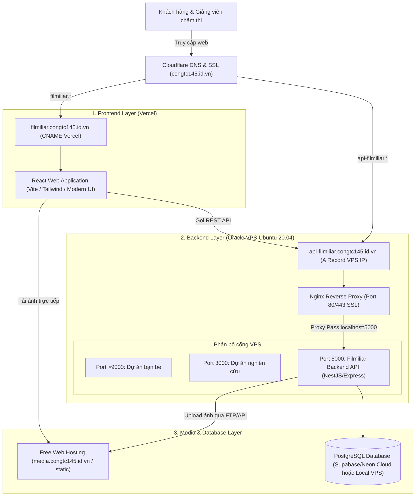
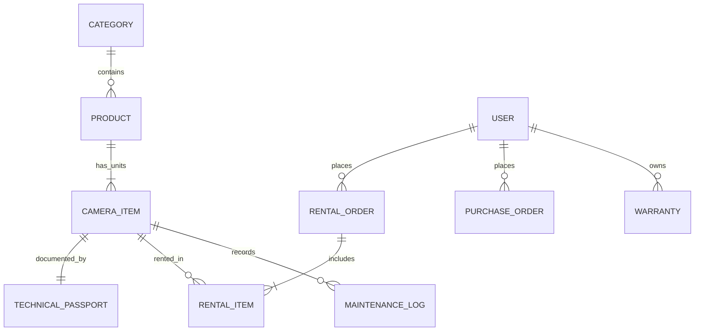

# KẾ HOẠCH TRIỂN KHAI DỰ ÁN HỆ THỐNG THƯƠNG MẠI ĐIỆN TỬ FILMILIAR
> **Đề tài**: Xây dựng chiến lược kinh doanh và nền tảng thương mại điện tử cho website cho thuê và bán máy ảnh second-hand kiểm định tại TP.HCM giai đoạn 2026-2029.  
> **Đơn vị thực hiện**: Nhóm 1 - Khóa Thương mại điện tử (UEH).  
> **Kiến trúc mục tiêu**: Client (Vercel) – Server (Oracle Cloud Free Tier VPS Ubuntu 20.04).

---

## 1. TỔNG QUAN DỰ ÁN & PHẠM VI NGHIỆP VỤ (BUSINESS SCOPE)

Từ nội dung đề cương trong file tiểu luận, **Filmiliar** ("Film" + "Familiar") là nền tảng thương mại điện tử O2O (Online-to-Offline) kết hợp mô hình kinh tế tuần hoàn:
1. **Dịch vụ cho thuê máy ảnh & ống kính theo ngày/dịp**: Nhắm đến người trẻ (18-30 tuổi), sinh viên, content creator, du lịch, concert, kỷ yếu.
2. **Kinh doanh máy ảnh & ống kính second-hand kiểm định**: Mua lại, tân trang, kiểm định và bán lại với đầy đủ bằng chứng kỹ thuật.
3. **Các tính năng "át chủ bài" (Core USPs) bắt buộc phải hoạt động trên web**:
   - **Technical Passport (Hồ sơ kỹ thuật thiết bị)**: Mỗi máy có mã định danh/serial riêng, hiển thị số shot (shutter count), tình trạng cảm biến, thấu kính, ảnh chụp các góc vết trầy xước thực tế, lịch sử bảo dưỡng và tỉ lệ độ mới (95%-99%).
   - **Camera Match Quiz**: Bộ trắc nghiệm tư vấn thông minh (mục đích chụp, kinh nghiệm, ngân sách) -> đưa ra gợi ý giải pháp: **Nên thuê bộ combo nào** hoặc **Nên mua máy nào** kèm lý do.
   - **Lịch trống thời gian thực & Đặt thuê trực tuyến (Real-time Rental Calendar)**: Chọn ngày nhận - trả, tự động tính tổng tiền thuê, tính tiền đặt cọc (deposit) minh bạch.
   - **Quy trình eKYC mô phỏng & Hợp đồng điện tử (e-Contract)**: Khách hàng tải CCCD mô phỏng và ký hợp đồng thuê online để giảm rủi ro tranh chấp.
   - **Bảo hành điện tử (e-Warranty)**: Áp dụng 3 - 6 tháng cho máy second-hand bán ra, theo dõi trong trang cá nhân.
   - **Trang quản trị (Admin & Vòng đời tài sản - Asset Lifecycle)**: Nhập máy -> Kiểm định -> Cho thuê -> Bảo dưỡng -> Bán lại second-hand.

---

## 2. THIẾT KẾ KIẾN TRÚC HỆ THỐNG (SYSTEM ARCHITECTURE)



---

## 3. PHÂN TÍCH HẠ TẦNG VPS ORACLE VÀ GIẢI PHÁP KỸ THUẬT

### 3.1. Hiện trạng VPS Oracle của bạn
* **Hệ điều hành**: Ubuntu 20.04 LTS (x86_64 hoặc ARM64 Ampere A1).
* **Tài nguyên**: 12GB RAM (rất dồi dào, thoải mái chạy nhiều dịch vụ), **24GB Ổ cứng Boot Volume** (Cần tiết kiệm không gian đĩa!).
* **Các dịch vụ hiện hữu**:
  - Dự án bạn bè: Chạy ở cổng `> 9000`.
  - Dự án nghiên cứu của bạn: Dự kiến chạy ở cổng `3000`.

### 3.2. Chiến lược định tuyến Domain & Phân bổ tài nguyên
1. **Bản đồ Tên miền trên Cloudflare (`congtc145.id.vn`)**:
   - **Frontend**: Tạo CNAME `filmiliar.congtc145.id.vn` trỏ về `cname.vercel-dns.com` (Vercel tự cấp SSL).
   - **Backend API**: Tạo bản ghi A `api-filmiliar.congtc145.id.vn` trỏ về IP công khai của Oracle VPS (bật proxy cam của Cloudflare để bảo vệ IP và có SSL tự động).
   - **Lưu trữ Media**: Tạo CNAME/A `media.congtc145.id.vn` hoặc dùng trực tiếp domain của gói hosting miễn phí để phục vụ ảnh.
2. **Cấu hình Nginx trên Oracle VPS**:
   - Nginx hiện tại đã hoạt động để định tuyến các cổng:
     - Domain/Subdomain bạn bè -> `localhost:900x`
     - Domain/Subdomain nghiên cứu -> `localhost:3000`
     - `api-filmiliar.congtc145.id.vn` -> `proxy_pass http://localhost:5000;`
3. **Chiến lược tối ưu ổ cứng 24GB VPS bằng Hosting ngoài**:
   - Hình ảnh sản phẩm, ảnh chụp thực tế tình trạng máy, vết xước cho Technical Passport và hợp đồng PDF sẽ được upload thẳng lên gói hosting miễn phí (thông qua FTP/SFTP tự động trong code Node.js hoặc HTTP endpoint).
   - Database chỉ lưu URL tĩnh (vd: `https://media.congtc145.id.vn/cameras/sony-a7m4-scratch-1.jpg`).
   - Kết quả: **VPS 24GB hoàn toàn sạch sẽ, không bị phình dung lượng lưu trữ media**.

---

## 4. CẤU TRÚC THƯ MỤC DỰ ÁN (MONOREPO ARCHITECTURE) & BỘ SKILLS TÍCH HỢP

### 4.1. Bộ Skills kỹ thuật đã import (`.agents/skills/`)
Dự án đã tích hợp 4 bộ kỹ năng chuẩn từ hệ thống để đảm bảo chất lượng code và thẩm mỹ ở mức cao nhất:
1. **`hallmark`**: Skill kỹ thuật thiết kế giao diện cao cấp (Anti-AI-slop), áp dụng macrostructure Bento-Grid, Photographic Fold, Spec Sheet chi tiết cho Technical Passport, hệ thống màu sắc điện ảnh (Cinematic tokens) và chuẩn tương tác 8 trạng thái (8-state UI).
2. **`vercel-react-best-practices`**: Chuẩn hóa hiệu năng, component lifecycle, routing và bundle size cho React triển khai trên Vercel.
3. **`supabase-postgres-best-practices`**: Tối ưu hóa kiến trúc PostgreSQL, truy vấn JSONB cho Technical Passport, Indexing và Transaction ACID chống trùng lịch thuê (Real-time Booking lock).
4. **`security-best-practices`**: Chuẩn bảo mật API, JWT Authentication, CORS chặt chẽ, sanitization dữ liệu tuân thủ Nghị định 13/2023/NĐ-CP về bảo vệ dữ liệu cá nhân.

### 4.2. Cấu trúc thư mục Monorepo chi tiết
```text
Filmiliar/
├── .agents/
│   └── skills/
│       ├── hallmark/                           # Thiết kế UI/UX & Design Tokens cao cấp
│       ├── vercel-react-best-practices/        # Tối ưu hóa React + Vercel
│       ├── supabase-postgres-best-practices/   # Chuẩn thiết kế PostgreSQL & ORM
│       └── security-best-practices/            # Chuẩn bảo mật API & dữ liệu
├── apps/
│   ├── client/                                 # FRONTEND (React + Vite + Vercel)
│   │   ├── public/                             # Favicon, mock media, icons
│   │   ├── src/
│   │   │   ├── assets/                         # Filmiliar branding, logo, mascot
│   │   │   ├── components/                     # Atomic & Modular UI (Hallmark standard)
│   │   │   │   ├── common/                     # Buttons, Badges, Modals, Inputs, DatePicker
│   │   │   │   ├── layout/                     # Header, Navbar, Footer, MegaMenu
│   │   │   │   ├── passport/                   # Technical Passport UI (Shutter, Sensor, Scratch zoom)
│   │   │   │   ├── quiz/                       # Camera Match Quiz step-by-step
│   │   │   │   ├── rental/                     # Real-time Booking Calendar, Deposit breakdown
│   │   │   │   └── admin/                      # Asset lifecycle management dashboard
│   │   │   ├── contexts/                       # AuthContext, CartContext, BookingContext
│   │   │   ├── hooks/                          # Custom hooks (useCalendar, useQuiz, usePassport)
│   │   │   ├── pages/                          # Home, Catalog, Detail, Quiz, Booking, Checkout, Admin
│   │   │   ├── services/                       # API Axios client kết nối api-filmiliar.congtc145.id.vn
│   │   │   ├── types/                          # TypeScript types & DTOs
│   │   │   ├── App.tsx
│   │   │   └── main.tsx
│   │   ├── package.json
│   │   ├── tailwind.config.js
│   │   ├── vite.config.ts
│   │   └── vercel.json                         # Vercel SPA routing rewrite rules
│   │
│   └── server/                                 # BACKEND (NestJS / Express + Oracle VPS Port 5000)
│       ├── prisma/                             # Prisma schema (PostgreSQL), migrations, seed data
│       │   ├── schema.prisma
│       │   └── seed.ts                         # Seed dữ liệu máy Sony, Fuji, Canon + Passport mẫu
│       ├── src/
│       │   ├── modules/
│       │   │   ├── auth/                       # JWT Auth, User profile, Mock eKYC
│       │   │   ├── cameras/                    # Quản lý máy ảnh, ống kính, tồn kho
│       │   │   ├── passport/                   # Technical Passport engine & lịch sử bảo dưỡng
│       │   │   ├── rental/                     # Lịch thuê thời gian thực & tính tiền cọc
│       │   │   ├── orders/                     # Đơn hàng mua second-hand & thanh toán
│       │   │   ├── quiz/                       # Thuật toán gợi ý Camera Match Quiz
│       │   │   └── media/                      # Pipeline upload ảnh sang Web Hosting qua FTP
│       │   ├── common/                         # Exception filters, interceptors, guards
│       │   ├── config/                         # Validation biến môi trường (.env)
│       │   ├── main.ts                         # Bootstrap (Port 5000, Swagger /api/docs, CORS)
│       │   └── app.module.ts
│       ├── package.json
│       ├── tsconfig.json
│       └── .env.example
├── docs/                                       # Tài liệu kiến trúc, sơ đồ ERD đưa vào bài tiểu luận
│   ├── system_architecture.md
│   └── erd_diagram.png
├── .gitignore
├── package.json                                # Monorepo root package
└── README.md
```

---

## 5. BẢN ĐỒ DỮ LIỆU & CÁC ENTITY CHÍNH (DATA SCHEMA)



* **Product**: Dòng sản phẩm (ví dụ: Sony A7 IV, Fujifilm X-T4, Canon EOS R6...).
* **CameraItem (Tài sản cá thể)**: Từng chiếc máy cụ thể có Serial Number, tình trạng (Trong kho, Đang cho thuê, Đang bảo dưỡng, Đã bán second-hand).
* **TechnicalPassport**: Gắn chặt với `CameraItem` (Shutter count, Sensor rating, Thấu kính rating, Ảnh chi tiết khuyết điểm, Ngày kiểm định gần nhất).
* **RentalOrder & BookingSchedule**: Quản lý lịch thuê từ ngày X đến ngày Y, tiền cọc, eKYC status, trạng thái hợp đồng, trạng thái bàn giao và hoàn cọc.
* **QuizRecommendation**: Lưu quy tắc match quiz hoặc logic thuật toán gợi ý máy.

---

## 5. LỘ TRÌNH TRIỂN KHAI THEO 4 GIAI ĐOẠN (SPRINT BREAKDOWN)

### Giai đoạn 1: Thiết kế Cơ sở dữ liệu & Xây dựng Backend Core (Oracle VPS)
* Khởi tạo cấu trúc Database (PostgreSQL / Supabase hoặc SQLite/Prisma).
* Viết RESTful API service (Port 5000):
  - API Danh mục sản phẩm & Chi tiết máy kèm Technical Passport.
  - API Camera Match Quiz (tính điểm gợi ý theo mục đích & ngân sách).
  - API Lịch thiết bị (kiểm tra ngày trống của từng máy).
  - API Đặt thuê & Đặt mua (Booking & Checkout Flow).
  - API Mô phỏng eKYC & Hợp đồng thuê.
  - API Quản trị Admin (Vòng đời máy: Nhập -> Kiểm định -> Thuê -> Trả -> Bảo dưỡng -> Bán).
* Thiết lập CORS cho phép frontend từ Vercel gọi về.

### Giai đoạn 2: Phát triển Giao diện Khách hàng & Quản trị (Frontend trên Vercel)
* Thiết lập project Next.js / Vite React, kết nối Vercel CI/CD tự động deploy khi push Git.
* Thiết kế hệ thống UI/UX cao cấp mang phong cách "Cinematic & Minimalist":
  - **Trang chủ**: Hero banner đậm chất nhiếp ảnh, Quick Rental Search theo ngày, Danh mục nổi bật.
  - **Trang Camera Match Quiz**: Bộ câu hỏi trắc nghiệm tương tác mượt mà, hiển thị kết quả "Bộ máy chân ái của bạn" kèm phân tích chi phí Thuê vs Mua.
  - **Trang Chi tiết sản phẩm & Technical Passport**: Trực quan hóa kết quả kiểm định cảm biến, số shot, kính lúp soi vết trầy xước.
  - **Trang Đặt thuê & Lịch chọn ngày**: Date picker trực quan, hiển thị ngày máy còn trống, tự động tính tổng tiền thuê và tiền cọc.
  - **Trang Checkout, eKYC & Ký hợp đồng điện tử**: Form xác minh CCCD mô phỏng và khung vẽ chữ ký điện tử.
  - **Trang Quản trị Admin (O2O Management)**: Dashboard thống kê tỷ lệ khai thác máy, lịch trả máy hôm nay, quản lý Technical Passport và kích hoạt bảo hành điện tử.

### Giai đoạn 3: Triển khai VPS Oracle & Tích hợp liên nền tảng (Integration & Deployment)
* Cấu hình VPS Oracle:
  - Cài đặt runtime (Node.js LTS / Python).
  - Cài đặt PM2 để giữ Backend API chạy nền bền bỉ, tự khởi động lại khi reboot.
  - Cấu hình Nginx / Cloudflare Tunnel trỏ về port `5000`.
  - Cấu hình biến môi trường kết nối giữa Frontend (Vercel) và Backend (Oracle VPS).
* Kiểm thử tích hợp toàn bộ luồng nghiệp vụ end-to-end.

### Giai đoạn 4: Hoàn thiện Sản phẩm Demo & Khớp dữ liệu vào Tiểu luận
* Tạo dữ liệu mẫu chân thực (Sony A7M4, Fujifilm X-T30, Canon R50... kèm ảnh Technical Passport chi tiết).
* Đóng gói kịch bản thuyết trình / video demo sản phẩm để nhóm đưa vào Phụ lục và Chương 3, Chương 4 của bài tiểu luận CLKDTMĐT.
